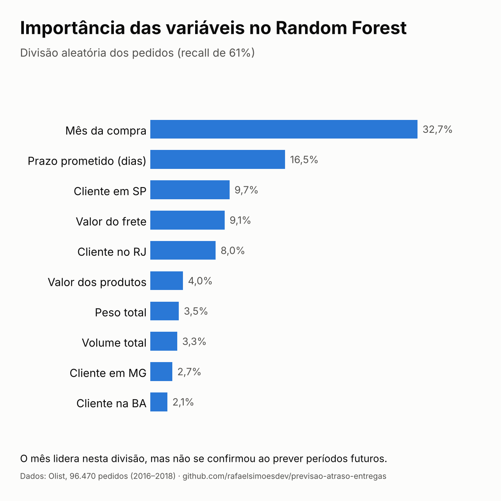

# Projeto 2 — Previsão de Atraso de Entrega

**Autor:** Rafael Simões  
**Dataset:** [Brazilian E-Commerce Public Dataset by Olist — Kaggle](https://www.kaggle.com/datasets/olistbr/brazilian-ecommerce)  
**Período dos dados:** 2016 a 2018  
**Pergunta:** Este pedido vai atrasar em relação à data prometida ao cliente?

> **Continuação:** este projeto foi revalidado e colocado no ar como API no [Projeto 3 — DeliveryRisk API](https://github.com/rafaelsimoesdev/deliveryrisk-api). Lá, um teste "treinar no passado, prever o futuro" mostrou que a variável `mes_compra`, a mais importante aqui, não generaliza. Veja a seção [Limitação importante](#limitação-importante-o-mês-da-compra).


   *Importância das variáveis na divisão aleatória dos pedidos. O mês da compra não se confirmou ao prever períodos futuros (veja [Limitação importante](#limitação-importante-o-mês-da-compra)).*

---

## Contexto

Atrasos de entrega são um dos maiores problemas de satisfação no e-commerce. Identificar com antecedência quais pedidos têm risco de atraso permite que a operação logística tome ações preventivas antes que o cliente seja impactado.

Este projeto treina um modelo de classificação capaz de prever, no momento da compra, se um pedido vai atrasar — usando apenas informações disponíveis naquele instante.

---

## Estrutura do Projeto

| Arquivo | Descrição |
|---|---|
| `p2_etapa1_explorar_atrasos.py` | Análise exploratória: taxa de atraso, padrões por mês e por estado |
| `p2_etapa2_preprocessamento.py` | Junção das tabelas, criação de pistas, tratamento de nulos e encoding |
| `p2_etapa3_modelos.py` | Treinamento e comparação dos modelos de classificação |
| `base_modelo.csv` | Base limpa gerada na Etapa 2 (não versionada) |

---

## Etapa 1 — Exploração dos Atrasos

96.470 pedidos entregues analisados entre 2016 e 2018.

- **Taxa de atraso geral: 6,8%** (6.534 pedidos)
- A taxa é baixa no geral, mas concentrada em regiões e períodos específicos

**Estados com maior taxa de atraso:**

| Estado | Taxa |
|---|---|
| Alagoas (AL) | 21,4% |
| Maranhão (MA) | 17,4% |
| Sergipe (SE) | 15,2% |
| Piauí (PI) | 13,9% |
| Ceará (CE) | 13,8% |

Os 5 estados com maior atraso são todos do Nordeste — provavelmente reflexo da distância dos centros de distribuição, concentrados no Sudeste, e do maior número de etapas logísticas.

**Variação mensal:** a taxa de atraso saltou para 12% em novembro de 2017 (Black Friday), 14% em fevereiro de 2018 e 19% em março de 2018. Esses episódios pontuais sobrecarregaram a operação, e é importante lembrar deles na Etapa 3.

---

## Etapa 2 — Pré-processamento

> **Regra de ouro:** só foram usadas informações disponíveis no momento da compra, para evitar vazamento de dados (*data leakage*).

**Pistas criadas (35 no total):**

| Pista | Descrição |
|---|---|
| `mes_compra` | Mês em que o pedido foi feito |
| `dia_semana_compra` | Dia da semana da compra |
| `prazo_prometido_dias` | Dias entre a compra e a data prometida |
| `qtd_itens` | Quantidade de itens no pedido |
| `valor_produtos` | Valor total dos produtos |
| `valor_frete` | Valor do frete |
| `peso_total_g` | Peso total dos produtos em gramas |
| `volume_total_cm3` | Volume total em cm³ |
| `estado_XX` (27 colunas) | Estado do cliente em formato one-hot encoding |

**Tratamento de nulos:** 22 pedidos sem peso e 16 sem volume (0,03% da base) — preenchidos com a mediana para não distorcer o modelo com valores extremos.

**Relação prazo × atraso:**

| Faixa de prazo | Taxa de atraso |
|---|---|
| Prazo curto | 6,3% |
| Médio-curto | 8,3% |
| Médio-longo | 7,3% |
| Prazo longo | 5,1% |

Prazos intermediários atrasam mais — provavelmente porque prazos muito curtos são dados apenas quando a entrega é garantida, e prazos muito longos têm folga suficiente para absorver imprevistos.

---

## Etapa 3 — Modelos de Classificação

### Por que não usar só a acurácia?

Com apenas 6,8% de atrasos, um modelo que responde "não vai atrasar" para todos os pedidos acerta 93,2% das vezes — mas nunca detecta nenhum atraso. A acurácia, sozinha, engana. Por isso a avaliação usa:

- **Precisão:** dos pedidos que o modelo sinalizou como atraso, quantos realmente atrasaram?
- **Recall:** dos pedidos que realmente atrasaram, quantos o modelo conseguiu identificar?
- **ROC-AUC:** a capacidade do modelo de ordenar os pedidos do menos ao mais arriscado, sem depender de um limiar. 0,50 equivale a um palpite aleatório.
- **PR-AUC:** semelhante ao ROC-AUC, mas mais exigente quando a classe é rara. Um modelo sem nenhum poder de previsão obtém um PR-AUC igual à taxa de atraso (aqui, 0,068).

Para operação logística, o recall é mais importante: é melhor investigar um pedido desnecessariamente do que deixar um atraso real passar sem aviso.

### Resultados

Todas as métricas vêm de 20% dos pedidos, separados antes do treino.

| Modelo | Acurácia | Precisão | Recall |
|---|---|---|---|
| Baseline (sempre "no prazo") | 93,2% | 0,0% | 0,0% |
| Gradient Boosting | 93,2% | 48,1% | 2,8% |
| Random Forest | 75,2% | 15,7% | 61,0% |

**Comparação com o baseline nas métricas que não dependem de limiar:**

| Modelo | ROC-AUC | PR-AUC |
|---|---|---|
| Baseline (palpite sem informação) | 0,50 | 0,068 |
| Random Forest | 0,756 | 0,212 |

O Random Forest atinge um PR-AUC mais de 3 vezes maior que o do baseline, então o modelo tem sinal real. O Gradient Boosting é o melhor exemplo de por que a acurácia engana: 93,2%, igual ao baseline, e só detectou 37 dos 1.307 atrasos.

### Matriz de confusão — Random Forest

| | Previu: No prazo | Previu: Atrasou |
|---|---|---|
| **Real: No prazo** | 13.709 | 4.278 |
| **Real: Atrasou** | 510 | 797 |

O modelo identificou 797 dos 1.307 atrasos no conjunto de teste — 61% de recall. Os 510 atrasos não detectados e os 4.278 alarmes falsos representam o trade-off esperado: para pegar mais atrasos, o modelo é mais conservador e sinaliza mais pedidos. Na prática, ele sinaliza cerca de 26% dos pedidos, e 15,7% desses alertas são atrasos reais, o que é 2,3 vezes a taxa média (6,8%).

### Pistas mais importantes (Random Forest)

| Pista | Importância |
|---|---|
| `mes_compra` | 0,327 |
| `prazo_prometido_dias` | 0,165 |
| `estado_SP` | 0,097 |
| `valor_frete` | 0,091 |
| `estado_RJ` | 0,080 |
| `valor_produtos` | 0,040 |
| `peso_total_g` | 0,035 |
| `volume_total_cm3` | 0,033 |
| `estado_MG` | 0,027 |
| `estado_BA` | 0,021 |

O mês da compra aparece como a pista mais importante, seguido pelo prazo prometido. Mas atenção ao que isso significa — veja a próxima seção.

---

## Limitação importante: o mês da compra

O `mes_compra` lidera o ranking, mas os dados cobrem apenas dois anos, e os atrasos se concentraram em episódios específicos (novembro de 2017 e fevereiro-março de 2018). Isso levanta uma dúvida: o modelo aprendeu algo que se repete todo ano ou apenas decorou o calendário desses dois anos?

Os números deste projeto vêm de uma divisão aleatória dos pedidos, que mistura todos os períodos entre treino e teste e não consegue responder a essa pergunta. No [Projeto 3](https://github.com/rafaelsimoesdev/deliveryrisk-api#validação-no-tempo-o-que-mudou-desde-o-projeto-2), eu testei isso treinando só com o que veio antes de cada período e prevendo o período seguinte. O resultado:

- Na divisão aleatória, o mês acrescentava cerca de 0,06 de ROC-AUC (0,756 com o mês, 0,694 sem).
- Ao prever o futuro, esse ganho **desaparece**: o mês ajuda em alguns períodos e atrapalha em outros.
- Sem o mês, o modelo mantém algum sinal em 3 dos 4 períodos testados (ROC-AUC de 0,64 a 0,69), mas fica próximo do acaso em jun-ago/2018.

**Conclusão:** os números deste projeto (ROC-AUC 0,756) são otimistas para o uso real. O mês da compra não deve ser tratado como uma regra de "períodos de pico causam atrasos", e o Projeto 3 removeu essa variável do modelo em produção.

---

## Conclusões

- O Random Forest com `class_weight='balanced'` foi o modelo mais útil para a operação, detectando 61% dos atrasos antes da entrega (ROC-AUC 0,756 e PR-AUC 0,212, contra 0,50 e 0,068 do baseline).
- O Gradient Boosting teve precisão maior (48%), mas recall de apenas 2,8%: quase inútil para detectar atrasos, apesar dos 93,2% de acurácia.
- O prazo prometido é um sinalizador de risco consistente. O mês da compra parece importante nesta divisão aleatória, mas não se confirmou ao prever períodos futuros (veja o Projeto 3).
- Os estados do Nordeste concentram as maiores taxas de atraso, provavelmente por causa das distâncias logísticas.
- As informações disponíveis no momento da compra dão um sinal modesto: faltam variáveis como transportadora, vendedor e distância real até o cliente.

---

## Como Reproduzir

```bash
# Instalar dependências
pip install pandas scikit-learn matplotlib

# Rodar as etapas em ordem
python p2_etapa1_explorar_atrasos.py
python p2_etapa2_preprocessamento.py
python p2_etapa3_modelos.py
```

Os arquivos CSV do dataset Olist precisam estar na mesma pasta dos scripts.  
Download: [kaggle.com/datasets/olistbr/brazilian-ecommerce](https://www.kaggle.com/datasets/olistbr/brazilian-ecommerce)
